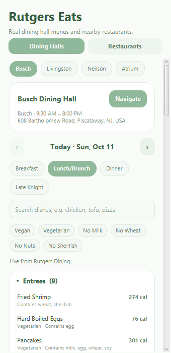
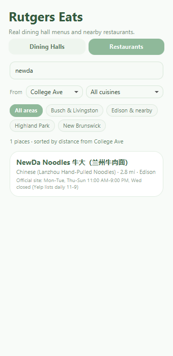
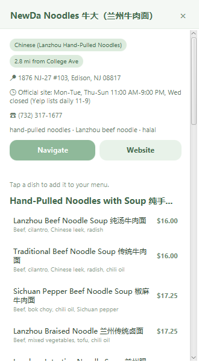
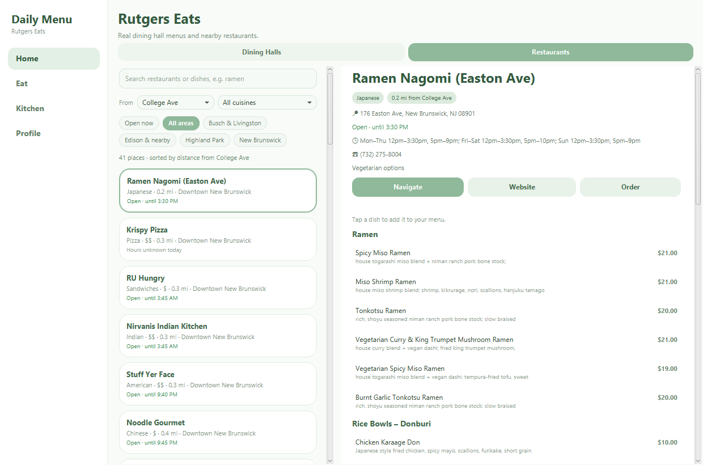

# Daily Menu

Daily Menu is a JavaFX desktop application for planning meals, exploring recipe suggestions, and keeping meal plans organized by account.

## Rutgers Eats (new)

The **Eat** tab helps Rutgers–New Brunswick students decide where to eat:

- **Dining Halls** — real menus for Busch, Livingston, Neilson and The Atrium, fetched live from
  Rutgers Dining's Nutrislice API (`rutgers.api.nutrislice.com`). Pick a hall, day (today + 6 days)
  and meal; search dishes; filter Vegan / Vegetarian / no milk, wheat, nuts or shellfish; tap a dish
  for calories, protein, carbs, fat and allergens. Menus are cached under `~/.daily-menu/cache` and a
  bundled snapshot is used offline.
- **Restaurants** — places near campus (downtown New Brunswick, Busch/Livingston, Highland Park,
  Edison) with menus collected from each restaurant's own website or ordering page. Search by
  restaurant **or dish** (e.g. "ramen"), filter by area and cuisine, sort by distance from your campus.
  Each restaurant page shows hours, phone, the menu with prices, and **Navigate** (Google Maps
  directions), **Website** and **Order** buttons. Every menu lists its source URL and the date it
  was checked.
- **Eat Now** on Home: which dining halls are open right now, until when, and headline dishes of
  the current meal; tap one to jump to its menu.
- **Open now** filter and live open/closed status for restaurants (parsed from their posted hours;
  days a source doesn't list show as "hours unknown", never as closed).
- Diet filters include **No Seafood** (fish + shellfish) and are remembered per account. Dishes
  without allergen data are excluded from allergen filters and labeled "No allergen info".
- Tap any dish to add it to your meal plan; it shows up on Home next to your home-cooked recipes.

| Dining halls | Search restaurants by dish | Restaurant menu + navigation |
|---|---|---|
|  |  |  |

### Desktop and phone layouts

The app opens as a normal resizable **desktop** window with a sidebar; the Eat tab uses columns
(filters on the left, menus or restaurant details on the right). Switch to the compact **phone**
layout under *Profile → Window Style* (no restart or re-login), or launch with `--phone` / `--desktop`:

```powershell
mvn javafx:run "-Djavafx.args=--phone"
```



### Refreshing the data

```powershell
python scripts/scrape_dining.py          # re-scrape the bundled dining-hall snapshot (this week)
python scripts/build_restaurants.py      # validate data/restaurants/*.json and rebuild the app resource
```

Restaurant source files live in `data/restaurants/`. Add or fix a restaurant there (keep
`menuSource` and `verifiedOn`), then run the build script.

## Features

- Create a local account or sign in to an existing account.
- Optionally remember the signed-in account on the current device.
- View a home page with the current date, time, greeting, daily plan, and saved meals.
- Use the calendar to plan meals for a selected date.
- Use Quick Start to choose meal preferences and receive a recipe suggestion.
- Browse recipe suggestions in the Kitchen page using food and meal preference tags.
- Review recipes and add selected meals to a plan.
- Manage profile details and application preferences.
- Store account and meal-plan data locally on the computer.

## Technology

- Java 17
- JavaFX 21.0.2
- Gson 2.11 (JSON)
- Maven
- Python 3 (optional, for the data scripts)

## Run from the Source Project on Windows

### Requirements

- JDK 17
- Maven
- The project files, including `pom.xml`

Open PowerShell in the project directory (the directory containing `pom.xml`) and run:

```powershell
mvn javafx:run
```

If PowerShell reports that `mvn` is not recognized, Maven is not on the system `PATH`. You can either add Maven's `bin` directory to `PATH` or use the full path to `mvn.cmd`. For the Maven installation used in this setup:

```powershell
& "D:\homework\Tools\apache-maven-3.10.0\bin\mvn.cmd" -f "D:\homework\DailyMenu\pom.xml" javafx:run
```

## Windows Installer (.msi)

```powershell
powershell -ExecutionPolicy Bypass -File scripts\package-windows.ps1 -WixDir C:\path	o\wix314
```

Needs JDK 17+, Maven and [WiX Toolset 3.x](https://github.com/wixtoolset/wix3/releases) (the
`wix314-binaries.zip` works without installing). Produces `target\installer\Daily Menu-<version>.msi`:
a per-user install (no admin rights) with Start-menu and desktop shortcuts and its own Java runtime.

## Build a Windows App Package

From the project directory, run:

```powershell
mvn clean javafx:jlink
```

If `mvn` is not on `PATH`, use the full Maven path instead:

```powershell
& "D:\homework\Tools\apache-maven-3.10.0\bin\mvn.cmd" -f "D:\homework\DailyMenu\pom.xml" clean javafx:jlink
```

After Maven reports `BUILD SUCCESS`, the package ZIP is created at:

```text
target\DailyMenu.zip
```

## Start the Packaged App

1. Extract the **entire** `DailyMenu.zip` archive to a folder, such as `D:\Apps\DailyMenu`.
2. Keep the extracted folder structure intact. Do not copy only the `bin` folder or an individual runtime file.
3. Open the extracted app folder, then open `bin`.
4. Double-click `DailyMenu.bat` to start the app.

The packaged image includes its Java runtime, so Maven and a separately installed Java runtime are not needed to launch this package. The package is a portable Windows app image, not a setup installer. To share it, distribute the ZIP or the complete extracted app folder.

## Local Data

Daily Menu stores account and meal-plan information locally on the computer. It does not provide cloud synchronization in this version. The Eat tab needs internet access for live dining hall menus; without it, the last saved or bundled menu is shown. Keep the application data on the same computer if you want to continue using the same local accounts and plans.

## Troubleshooting

- **`mvn` is not recognized:** Use the full path to `mvn.cmd` shown above, or add Maven's `bin` directory to the Windows `PATH`.
- **The app package does not start:** Confirm that the entire ZIP was extracted and run `bin\DailyMenu.bat` from the extracted package. Do not launch `java.exe` directly.
- **Maven build fails:** Check that JDK 17 is installed and that the PowerShell terminal is in the directory containing `pom.xml`.

